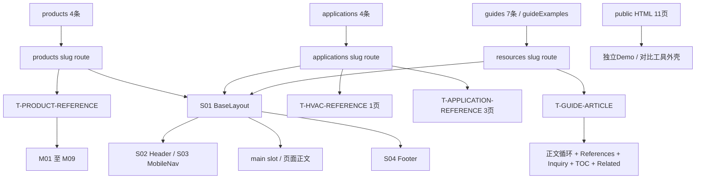

# 当前网站结构蓝图

提取日期：2026-10-12。项目根：`D:/Hangxing/workspace`。依据本次当前源码、数据求值及本机初始浏览器 DOM；这是结构逆向记录，不包含评价或改造建议。

## 范围与验证口径

- 已读取全局 `C:/Users/Administrator/.codex/AGENTS.md`（与用户提供规则一致）。`D:/AGENTS.md`、`D:/Hangxing/AGENTS.md`、项目内 AGENTS.md 未发现；项目没有 `.codegraph/`，不使用 CodeGraph。Skill：`C:/Users/Administrator/.agents/skills/site-architecture/SKILL.md`；仅应用其结构/URL/导航记录方法，不执行规划、优先级评价或重设计。
- 实际网站来源为 `src/pages`、`src/layouts`、`src/components`、全部 `src/data`、`astro.config.mjs`、`package.json`、`src/lib/publicSite.ts` 和 `public`。没有 Astro content collection/config 或 src/content 目录；文章来自 src/data/guides.ts。项目/父目录常用 product-marketing context 路径未发现文件。
- **33 个 Astro HTML 页面 = 18 个文件型页面 + 15 个数据生成页面**（4产品、4应用、7指南）；另有 **11 个 public HTML 设计试验页**，合计 **44 个可对应到当前项目文件的 HTML 页面**。另外3个非HTML端点：sitemap.xml、robots.txt、POST API inquiries。
- **SOURCE**：当前源码与数据求值已核对；**DOM**：44页在本轮启动的 `http://127.0.0.1:4325` 初始浏览器 DOM 中均读取到正确页面内容，包括客户端岛的初始内容；**STATE**：只核对少量合法 query 预填与指南手机顺序，其余条件状态按源码记录；**UNCONFIRMED**：外部部署、生产URL、HTTP状态码、SMTP/真实送达、媒体播放/全部图片解码、全部交互和外部资料真实性。
- 本轮浏览器阻止 XML 端点导航，因此 sitemap/robots 仅按已读源码记录，不能称运行响应已验证；未知 URL 的404状态码/回退也未本轮确认。`/404/` 文件内容已实际读取。
- 当前用户打开的 `:8766/round-08-full-home/style-explorer.html` 属于 `.qa/oil-home-directions-20261010` 独立预览服务器的历史设计交付，**不是 Astro src/public 路由**。上述44页不混入 `.qa`、dist、.cloudflare-candidate、design-exploration 或 backup 目录。当前正式首页源码已含 porcelain 主视觉与更新后的生产图片，本次以该源码为准，不以旧截图推定。
- M编号是**页面内业务模块**，共享外壳 S 编号只登记一次；详情见 [module-inventory.md](module-inventory.md)。并排区域说明列/阅读流，CSS改序单列；隐藏dialog/details或条件结果不表示初始视觉中已经展示。

## 配置与路由生成

`astro.config.mjs:1–21`：server output、node standalone、React integration、trailingSlash=always；site来自 PUBLIC_SITE_URL 或 http://localhost:4321，配置端口4321。本轮为读取当前源码临时使用4325，不将该地址视为部署地址。未发现配置 redirects、middleware、catch-all、locale前缀、分类分页或额外rewrite文件。

| 路由族 | 生成表达式 | 输入/数量 | 实现 |
|---|---|---|---|
| `/products/{slug}/` | products.map → params.slug/props.product；prerender=true | src/data/site.ts products 4条 | src/pages/products/[slug].astro:7–8 |
| `/applications/{slug}/` | applications.map → params.slug/props.application；prerender=true | src/data/site.ts applications 4条 | src/pages/applications/[slug].astro:6–7 |
| `/resources/{slug}/` | guides.map → params.slug/props.guide；prerender=true | src/data/guides.ts guides 7条 | src/pages/resources/[slug].astro:7–8 |
| 文件型Astro | src/pages文件路径，index折叠为目录根 | 18条；默认SSR，无额外getStaticPaths | 对应各页面文件 |
| public HTML | public下相对路径直接作为URL | 11条，不参与Astro模板或数据getStaticPaths | public/home-directions-20261010及r2 |

照片ID P001–P096、configuration ID、request/guide/series/application 参数、#inquiry-form 等锚点属于已有页面内容/状态；没有据这些值建立独立URL页面。`/request-a-quote/` 当前是完整准备页，不是 redirect。

## 全站结构树

```text
/
├─ products/
│  ├─ cbb60-motor-run-capacitor/
│  ├─ cbb61-fan-capacitor/
│  ├─ cbb65-air-conditioner-capacitor/
│  ├─ cd60-start-capacitor/
│  └─ photographs/ (目录/页脚/上下文入口)
├─ applications/
│  ├─ hvac-refrigeration/
│  ├─ pumps-water-systems/
│  ├─ fans-ventilation/
│  └─ appliances-small-motors/
├─ oem-quality/ (一级导航分组)
├─ oem/
├─ factory/
│  └─ packing-and-dispatch/
├─ resources/
│  ├─ start-vs-run-capacitors/
│  ├─ cbb60-vs-cbb61-vs-cbb65/
│  ├─ single-vs-dual-run-capacitors/
│  ├─ read-motor-capacitor-label/
│  ├─ capacitance-voltage-guide/
│  ├─ dimensions-terminals-mounting/
│  └─ motor-capacitor-order-shipment-checklist/
├─ buying-guide/
├─ faq/
├─ about/
├─ contact/ (Header CTA)
├─ privacy-policy/ (Footer)
├─ request-a-quote/ (noindex，非redirect)
├─ thank-you/ (noindex，sessionStorage状态)
├─ typography-preview/ (noindex，字体样张)
├─ 404/ (noindex，错误文件)
├─ home-directions-20261010/
│  ├─ a.html / b.html / c.html / d.html / e.html / style-explorer.html
│  └─ r2/object.html / studio.html / editorial.html / red-object.html / style-explorer.html
├─ sitemap.xml (非HTML)
├─ robots.txt (非HTML)
└─ api/inquiries/ (POST，非HTML)
```

该树表示实际 URL 与文件层级，OEM & quality 的导航分组关系并不改变 /oem/、/factory/ 的 URL。



## 一级与二级导航（保持真实配置顺序）

Header 中 `primaryNav` 有5组，Contact是额外独立CTA。桌面一级标题是可点击父URL；手机一级summary为展开分组，子组首链接通常到父页。Logo→/；导航来源 `src/data/site.ts:164–170`，桌面 src/components/Header.astro:8–14，手机 src/components/MobileNav.tsx:21–25。

| 顺序 | 一级导航 | 一级URL | 二级导航 | 二级URL |
|---|---|---|---|---|
| 1 | Products | `/products/` | All motor capacitors | `/products/` |
| 1 | Products | `/products/` | CBB60 · Motor run | `/products/cbb60-motor-run-capacitor/` |
| 1 | Products | `/products/` | CBB61 · Fan run | `/products/cbb61-fan-capacitor/` |
| 1 | Products | `/products/` | CBB65 · HVAC run | `/products/cbb65-air-conditioner-capacitor/` |
| 1 | Products | `/products/` | CD60 · Motor start | `/products/cd60-start-capacitor/` |
| 2 | Applications | `/applications/` | All applications | `/applications/` |
| 2 | Applications | `/applications/` | HVAC & refrigeration | `/applications/hvac-refrigeration/` |
| 2 | Applications | `/applications/` | Pumps & water systems | `/applications/pumps-water-systems/` |
| 2 | Applications | `/applications/` | Fans & ventilation | `/applications/fans-ventilation/` |
| 2 | Applications | `/applications/` | Appliances & small motors | `/applications/appliances-small-motors/` |
| 3 | OEM & quality | `/oem-quality/` | Overview | `/oem-quality/` |
| 3 | OEM & quality | `/oem-quality/` | OEM & private label | `/oem/` |
| 3 | OEM & quality | `/oem-quality/` | Manufacturing & quality | `/factory/` |
| 3 | OEM & quality | `/oem-quality/` | Packing & dispatch | `/factory/packing-and-dispatch/` |
| 4 | Resources | `/resources/` | Technical guides | `/resources/` |
| 4 | Resources | `/resources/` | RFQ checklist | `/buying-guide/` |
| 4 | Resources | `/resources/` | Order & shipment checklist | `/resources/motor-capacitor-order-shipment-checklist/` |
| 4 | Resources | `/resources/` | Buyer FAQ | `/faq/` |
| 5 | About | `/about/` | Company & supplier records | `/about/` |
| CTA | Contact | `/contact/` | — | — |

## 页脚与其他共享入口

来源：`src/components/Footer.astro:6–12`。这份表是共享导航记录，不在每页模块重复展开。

| 分组 | 链接文本 | URL |
|---|---|---|
| Brand | HAN XING | `/` |
| Brand | Company & supplier records | `/about/` |
| Products & applications | CBB60 · Motor run | `/products/cbb60-motor-run-capacitor/` |
| Products & applications | CBB61 · Fan run | `/products/cbb61-fan-capacitor/` |
| Products & applications | CBB65 · HVAC run | `/products/cbb65-air-conditioner-capacitor/` |
| Products & applications | CD60 · Motor start | `/products/cd60-start-capacitor/` |
| Products & applications | Original sample photographs | `/products/photographs/` |
| Products & applications | Applications | `/applications/` |
| Buying & technical support | OEM & private label | `/oem/` |
| Buying & technical support | Manufacturing & quality | `/factory/` |
| Buying & technical support | Packing & dispatch | `/factory/packing-and-dispatch/` |
| Buying & technical support | RFQ checklist | `/buying-guide/` |
| Buying & technical support | Order & shipment checklist | `/resources/motor-capacitor-order-shipment-checklist/` |
| Buying & technical support | Technical guides | `/resources/` |
| Buying & technical support | FAQ | `/faq/` |
| Hanxing company contact | ManuelaMusio570@gmail.com | `mailto:ManuelaMusio570@gmail.com` |
| Hanxing company contact | WhatsApp · +86 153 3339 4111 | `https://wa.me/8615333394111` |
| Bottom | Privacy policy | `/privacy-policy/` |

页面局部入口：产品详情的 Specifications / Samples & fit / Applications / OEM & purchasing / Documents；指南的 On this page / Related resources；About 的 Supplier records；资源目录 Resource shortcuts；Footer、各卡片与询盘CTA的实际 href 全部在模块清单对应记录。面包屑是内联 S05 模式，未建立独立组件。

## 页面 → 模板 → 模块 → 源码总映射

全部44页均为 SOURCE+DOM；条件行为按各页模块说明标记。详情/页特有内容在 [module-inventory.md](module-inventory.md)，模板规则在 [page-templates.md](page-templates.md)。M编号每页重置；如联系页M04、弹层状态，仅在条件成立时可见。

| 页面 | 实际H1/工具标题 | 模板 | 完整模块链 | 入口源码/生成数据 | 导航/入口 |
|---|---|---|---|---|---|
| `/404/` | Page not found | T-ST-ERROR | M01 | `src/pages/404.astro:1` | 非Header入口；可直接访问 |
| `/about/` | About HAN XING | T-ST-ABOUT | M01 → M02 → M03 → M04 | `src/pages/about.astro:1` | Header一级/二级或CTA |
| `/applications/` | Motor capacitors by application | T-APPLICATION-DIRECTORY | M01 → M02 | `src/pages/applications/index.astro:1` | Header一级/二级或CTA |
| `/buying-guide/` | Prepare a capacitor RFQ | T-ST-RFQ | M01 → M02 → M03 → M04 | `src/pages/buying-guide.astro:1` | Header一级/二级或CTA |
| `/contact/` | Discuss your motor capacitor requirements | T-ST-CONTACT | M01 → M02 → M03 → M04 | `src/pages/contact.astro:1` | Header一级/二级或CTA |
| `/factory/packing-and-dispatch/` | Packing and dispatch for your order | T-ST-PACKING | M01 → M02 → M03 → M04 → M05 | `src/pages/factory/packing-and-dispatch.astro:1` | Header一级/二级或CTA |
| `/factory/` | Manufacturing and quality | T-ST-FACTORY | M01 → M02 → M03 → M04 → M05 | `src/pages/factory.astro:1` | Header一级/二级或CTA |
| `/faq/` | Motor capacitor buying questions | T-ST-FAQ | M01 → M02 → M03 → M04 | `src/pages/faq.astro:1` | Header一级/二级或CTA |
| `/` | Capacitor supply for equipment manufacturers. | T-ST-HOME | M01 → M02 → M03 → M04 → M05 | `src/pages/index.astro:1` | Header一级/二级或CTA |
| `/oem-quality/` | OEM and quality | T-ST-CAPABILITY-HUB | M01 → M02 → M03 → M04 | `src/pages/oem-quality.astro:1` | Header一级/二级或CTA |
| `/oem/` | OEM motor capacitors | T-ST-OEM | M01 → M02 → M03 | `src/pages/oem.astro:1` | Header一级/二级或CTA |
| `/privacy-policy/` | Privacy notice | T-ST-NOTICE | M01 → M02 → M03 → M04 → M05 | `src/pages/privacy-policy.astro:1` | Footer / 目录 / 上下文 |
| `/products/` | Motor capacitor series | T-PRODUCT-CATALOG | M01 → M02 → M03 → M04 | `src/pages/products/index.astro:1` | Header一级/二级或CTA |
| `/products/photographs/` | Product sample photographs | T-SAMPLE-LIBRARY | M01 → M02 | `src/pages/products/photographs.astro:1` | Footer / 目录 / 上下文 |
| `/request-a-quote/` | Request a motor capacitor quote | T-ST-QUOTE-PREP | M01 → M02 → M03 | `src/pages/request-a-quote.astro:1` | 非Header入口；可直接访问 |
| `/resources/` | Motor capacitor resources | T-RESOURCE-INDEX | M01 → M02 → M03 → M04 → M05 → M06 | `src/pages/resources/index.astro:1` | Header一级/二级或CTA |
| `/thank-you/` | Inquiry status | T-ST-STATUS | M01 → M02 → M03 | `src/pages/thank-you.astro:1` | 非Header入口；可直接访问 |
| `/typography-preview/` | Typography system | T-ST-TYPE-SPECIMEN | M01 → M02 → M03 | `src/pages/typography-preview.astro:1` | 非Header入口；可直接访问 |
| `/products/cbb60-motor-run-capacitor/` | CBB60 motor run capacitors | T-PRODUCT-REFERENCE | M01 → M02 → M03 → M04 → M05 → M06 → M07 → M08 → M09 | `src/pages/products/[slug].astro:7–18；src/data/site.ts::products[slug=cbb60-motor-run-capacitor]` | Header一级/二级或CTA |
| `/products/cbb61-fan-capacitor/` | CBB61 fan capacitors | T-PRODUCT-REFERENCE | M01 → M02 → M03 → M04 → M05 → M06 → M07 → M08 → M09 | `src/pages/products/[slug].astro:7–18；src/data/site.ts::products[slug=cbb61-fan-capacitor]` | Header一级/二级或CTA |
| `/products/cbb65-air-conditioner-capacitor/` | CBB65 HVAC capacitors | T-PRODUCT-REFERENCE | M01 → M02 → M03 → M04 → M05 → M06 → M07 → M08 → M09 | `src/pages/products/[slug].astro:7–18；src/data/site.ts::products[slug=cbb65-air-conditioner-capacitor]` | Header一级/二级或CTA |
| `/products/cd60-start-capacitor/` | CD60 motor start capacitors | T-PRODUCT-REFERENCE | M01 → M02 → M03 → M04 → M05 → M06 → M07 → M08 → M09 | `src/pages/products/[slug].astro:7–18；src/data/site.ts::products[slug=cd60-start-capacitor]` | Header一级/二级或CTA |
| `/applications/hvac-refrigeration/` | HVAC & refrigeration | T-HVAC-REFERENCE | M01 → M02 → M03 | `src/pages/applications/[slug].astro:6–12；src/data/site.ts::applications[slug=hvac-refrigeration]` | Header一级/二级或CTA |
| `/applications/pumps-water-systems/` | Pumps & water systems | T-APPLICATION-REFERENCE | M01 → M02 → M03 | `src/pages/applications/[slug].astro:6–12；src/data/site.ts::applications[slug=pumps-water-systems]` | Header一级/二级或CTA |
| `/applications/fans-ventilation/` | Fans & ventilation | T-APPLICATION-REFERENCE | M01 → M02 → M03 | `src/pages/applications/[slug].astro:6–12；src/data/site.ts::applications[slug=fans-ventilation]` | Header一级/二级或CTA |
| `/applications/appliances-small-motors/` | Appliances & small motors | T-APPLICATION-REFERENCE | M01 → M02 → M03 | `src/pages/applications/[slug].astro:6–12；src/data/site.ts::applications[slug=appliances-small-motors]` | Header一级/二级或CTA |
| `/resources/start-vs-run-capacitors/` | Start capacitor vs run capacitor | T-GUIDE-ARTICLE | M01 → M02 → M03 → M04 → M05 → M06 → M07 → M08 | `src/pages/resources/[slug].astro:7–36；src/data/guides.ts::guides[slug=start-vs-run-capacitors]` | Resources目录 / 相关内容 |
| `/resources/cbb60-vs-cbb61-vs-cbb65/` | CBB60 vs CBB61 vs CBB65 | T-GUIDE-ARTICLE | M01 → M02 → M03 → M04 → M05 → M06 → M07 → M08 | `src/pages/resources/[slug].astro:7–36；src/data/guides.ts::guides[slug=cbb60-vs-cbb61-vs-cbb65]` | Resources目录 / 相关内容 |
| `/resources/single-vs-dual-run-capacitors/` | Single-run vs dual-run capacitors | T-GUIDE-ARTICLE | M01 → M02 → M03 → M04 → M05 → M06 → M07 → M08 | `src/pages/resources/[slug].astro:7–36；src/data/guides.ts::guides[slug=single-vs-dual-run-capacitors]` | Resources目录 / 相关内容 |
| `/resources/read-motor-capacitor-label/` | Reading a motor capacitor label | T-GUIDE-ARTICLE | M01 → M02 → M03 → M04 → M05 → M06 → M07 → M08 | `src/pages/resources/[slug].astro:7–36；src/data/guides.ts::guides[slug=read-motor-capacitor-label]` | Resources目录 / 相关内容 |
| `/resources/capacitance-voltage-guide/` | Motor capacitor capacitance and voltage | T-GUIDE-ARTICLE | M01 → M02 → M03 → M04 → M05 → M06 → M07 → M08 | `src/pages/resources/[slug].astro:7–36；src/data/guides.ts::guides[slug=capacitance-voltage-guide]` | Resources目录 / 相关内容 |
| `/resources/dimensions-terminals-mounting/` | Motor capacitor dimensions, terminals and mounting | T-GUIDE-ARTICLE | M01 → M02 → M03 → M04 → M05 → M06 → M07 → M08 | `src/pages/resources/[slug].astro:7–36；src/data/guides.ts::guides[slug=dimensions-terminals-mounting]` | Resources目录 / 相关内容 |
| `/resources/motor-capacitor-order-shipment-checklist/` | Motor capacitor order and shipment checklist | T-GUIDE-ARTICLE | M01 → M02 → M03 → M04 → M05 → M06 → M07 → M08 → M09 → M10 → M11 | `src/pages/resources/[slug].astro:7–36；src/data/guides.ts::guides[slug=motor-capacitor-order-shipment-checklist]` | Header一级/二级或CTA |
| `/home-directions-20261010/a.html` | Motor capacitors.Clearly matched. | T-PUBLIC-HOME-DEMO | M01 → M02 → M03 | `public/home-directions-20261010/a.html:1` | 独立预览/对比工具 |
| `/home-directions-20261010/b.html` | The right capacitor.A considered choice. | T-PUBLIC-HOME-DEMO | M01 → M02 → M03 | `public/home-directions-20261010/b.html:1` | 独立预览/对比工具 |
| `/home-directions-20261010/c.html` | Match the motor.Specify the capacitor. | T-PUBLIC-HOME-DEMO | M01 → M02 → M03 | `public/home-directions-20261010/c.html:1` | 独立预览/对比工具 |
| `/home-directions-20261010/d.html` | Capacitor supplyfor equipmentmanufacturers. | T-PUBLIC-HOME-DEMO | M01 → M02 → M03 | `public/home-directions-20261010/d.html:1` | 独立预览/对比工具 |
| `/home-directions-20261010/e.html` | Find the capacitorfor your equipment. | T-PUBLIC-HOME-DEMO | M01 → M02 | `public/home-directions-20261010/e.html:1` | 独立预览/对比工具 |
| `/home-directions-20261010/r2/editorial.html` | A small component.A precise choice. | T-PUBLIC-HOME-DEMO | M01 → M02 → M03 | `public/home-directions-20261010/r2/editorial.html:1` | 独立预览/对比工具 |
| `/home-directions-20261010/r2/object.html` | Motor capacitors.Run & start. | T-PUBLIC-HOME-DEMO | M01 → M02 → M03 | `public/home-directions-20261010/r2/object.html:1` | 独立预览/对比工具 |
| `/home-directions-20261010/r2/red-object.html` | Fan capacitors.In focus. | T-PUBLIC-HOME-DEMO | M01 → M02 → M03 | `public/home-directions-20261010/r2/red-object.html:1` | 独立预览/对比工具 |
| `/home-directions-20261010/r2/studio.html` | Motor run. Motor start. | T-PUBLIC-HOME-DEMO | M01 → M02 → M03 | `public/home-directions-20261010/r2/studio.html:1` | 独立预览/对比工具 |
| `/home-directions-20261010/r2/style-explorer.html` | HAN XING · 精品产品品牌 · 风格对比 · Oil UI Pro（无 H1） | T-PUBLIC-EXPLORER | M01 → M02 | `public/home-directions-20261010/r2/style-explorer.html:1` | 独立预览/对比工具 |
| `/home-directions-20261010/style-explorer.html` | HAN XING · 首页方向比较 · 风格对比 · Oil UI Pro（无 H1） | T-PUBLIC-EXPLORER | M01 → M02 | `public/home-directions-20261010/style-explorer.html:1` | 独立预览/对比工具 |

## 非HTML端点与内部接入边界

| 端点 | 当前实现 | 源码验证/未确认 |
|---|---|---|
| `/sitemap.xml` GET | GET拼接28个路径：首页、产品目录+4详情、应用目录+4详情、oem-quality/oem/factory/packing/buying-guide/resources+7指南、faq/about/contact/privacy。没有photographs/request/thank-you/typography/404/public试验HTML | src/pages/sitemap.xml.ts:1–9；URL origins由site决定；本轮XML响应未确认 |
| `/robots.txt` GET | publicSiteReady=true时Disallow api/thank-you/request-a-quote并指向sitemap；false时Disallow / | src/pages/robots.txt.ts:1–8；src/lib/publicSite.ts；本轮响应未确认 |
| `/api/inquiries/` POST | 校验字段/规格/附件、创建inquiry记录及附件；DEV返回local_preview，不发邮件；非DEV要求storage/SMTP配置，发销售通知及可选确认、保存delivery记录 | src/pages/api/inquiries.ts:1–78；未调用POST，未读取部署密钥/配置，未验证送达。当前contact无该调用；仅未接入QuoteForm含fetch |

API源码读取的环境变量名为 INQUIRY_STORE_DIR、SALES_NOTIFY_EMAIL、SMTP_HOST/PORT/USER/PASSWORD/FROM；文档不读取或写入其值。附件允许最多4个PDF/JPEG/PNG/WebP、每5MB，请求22MB；规格1–5条。该端点存在并不表示当前网站已经接入文件上传或在线提交。端点不是页面模块，不编造HTML模板。

## 数据 → 页面来源

| 数据 | 当前消费/作用 | 当前未渲染字段或未接入边界 |
|---|---|---|
| src/data/site.ts | public constants、products4、applications4、primaryNav；首页/目录/详情/导航/页脚/询盘参数验证 | catalogImage/catalogImageAlt 不被当前目录/详情/应用图渲染；procurement/notes/decisionChecks、application.checks 不直接用在当前详情正文 |
| src/data/productReference.ts | 4产品详情的介绍、应用链接、机械检查与文档内容 | 不是新路由数据；按code键选择 |
| src/data/productPhotos.ts + src/data/sampleLibrary.json | 产品详情图库；照片库96条；CBB60详情排除P001–P003 | Additional samples只在96库，不生成详情产品URL |
| src/data/sampleConfigurations.ts | ProductReference的主/备选机械样本；contact configuration上下文 | 独立SampleConfigurations组件未接入；sampleID不是页面 |
| src/data/applicationReference.ts | 3通用应用详情；showDimensions等条件 | HVAC走HvacReference独立组件 |
| src/data/guides.ts + src/data/guideExamples.ts | 7文章路径、正文小节、References/Inquiry/Related、16图例；联系页guide参数 | category字段不生成分类页；未提供分页/搜索路由 |
| src/data/guideCovers.ts | 仅未接入的GuideThumbnail消费 | 当前资源目录没有封面图模块 |
| src/data/illustrativeScenes.ts / src/data/media.ts | 无当前src/pages依赖链消费 | 不能据库存数据添加当前页面模块 |

没有路由源码/导航配置支持当前项目内的 Cases/Case studies、Customers、Certificates、Downloads、News/Blog、标签/分类/语言独立页；对外部原站链接不转换成本项目路由。产品列表为四个系列，不是全部rating×voltage×dimensions SKU页面。

## 提取证据与不可确认项

- 只读快照：`.qa/blueprint-20261012/source-before.json`；所有src/public/config/package文件在完成时作哈希复核。运行预览可能生成.astro与Vite缓存，不代表业务源码改动。
- 路由/依赖/数据：route-census.json、import-graph.json、source-data.json。初始DOM：rendered-pages.json（44页）。条件实例：runtime-conditions.json（合法contact参数预填、quote转参、1440/390指南顺序）。
- `/contact/` 已确认合法上下文能填入series/request/message；当configuration与photo同时有效时，message优先configuration。没有填写姓名、提交草稿或打开外部app。
- `/request-a-quote/` 合法query在本机SSR条件下确实出现在contact CTA；生产预渲染或外部托管行为未确认。
- 指南start-vs-run在1440下正文左、TOC/Related右且TOC打开；390下TOC第1行/正文第2行/Related第3行且TOC关闭。其他交互/断点按当前源码和最终CSS记录。
- 初始DOM存在dialog/closed details内节点不表示它们初始视觉可见；资产文件存在不表示播放/解码/影像真实性已验证。
- 全站未调用 inquiry POST，未尝试外部邮件/WhatsApp发送，未部署、未读取生产状态。所有外部参考只记录源码链接；不核验其当前外部内容。
